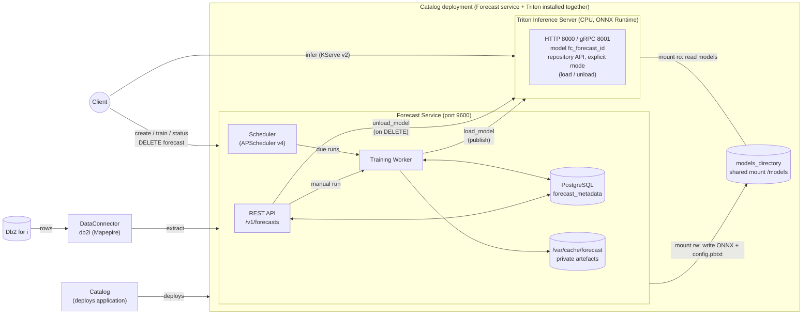
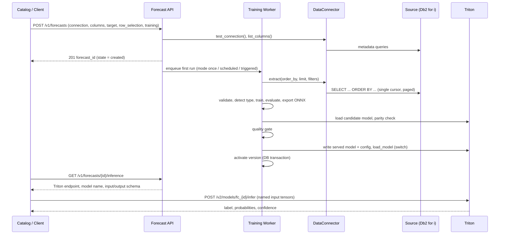
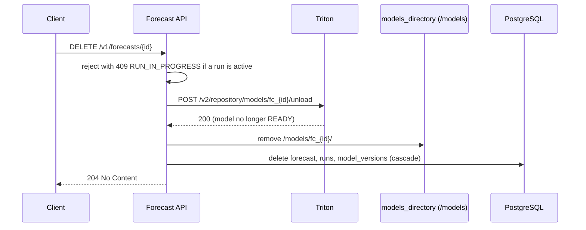
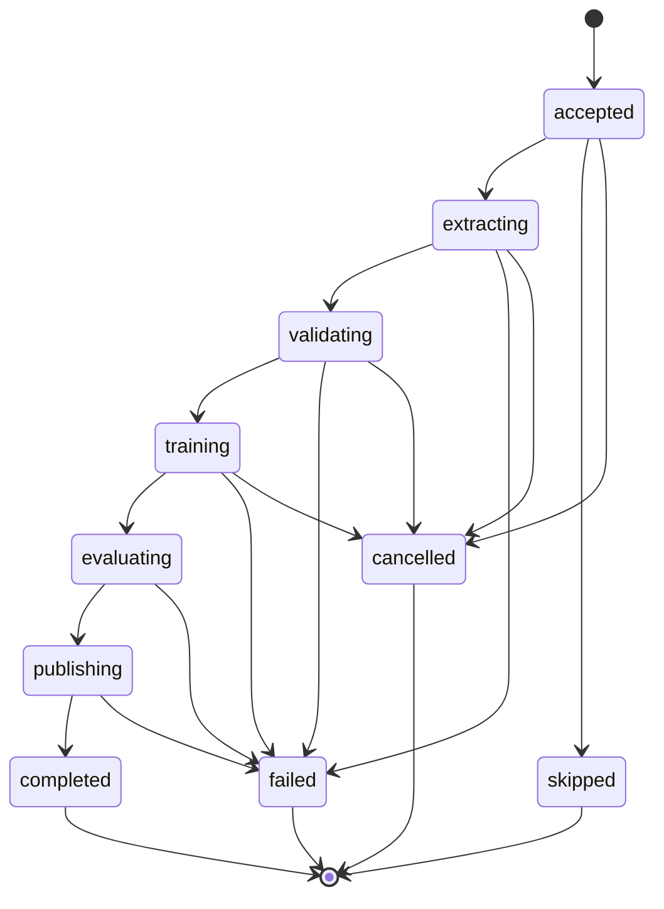

# Forecast Service — Design Proposal

> **Status:** Draft for review. This is a design proposal only; no service code is part of this change.
> Items marked **TBD** are to be provided by the owning team (DEV, Platform, Product or Catalog).

## 1. Overview

This document proposes the design of the **Forecast** service for the AI-Services platform. Forecast predicts future trends and outcomes from historical, tabular data held in **Db2 for i**. It supports planning, resource allocation and business decisions.

**Scope of this proposal:** Db2 for i is the only data source. CSV file input is a **stretch goal** ([Section 5.3](#53-stretch-csv-file-connector)); Oracle and EDB are future work. The connector contract is kept generic so those can be added without service changes, but they are not designed here.

A user (at deploy time) points the service at a table, picks one or more **input columns** and one **target column**, optionally restricts which rows are used for training, and chooses how often the model is retrained. The service then:

1. Pulls the training rows from the source through a **data connector**.
2. Trains a model on CPU (MMA/SIMD) with AutoGluon Tabular. LightGBM, XGBoost and others are selectable.
3. Publishes a versioned model as ONNX into a shared `models_directory`, where **Triton Inference Server on CPU** serves it. Clients send inference requests **directly to Triton**; they do not pass through the Forecast API.
4. Retrains on request, on a schedule, or once, without service downtime.

The service follows the established platform patterns:

- FastAPI application in a Podman container (ppc64le / RHEL), single replica.
- PostgreSQL for durable metadata, initialised by an idempotent init container.
- Job table + boot-time zombie recovery (entity extraction, digitize).
- APScheduler `AsyncScheduler` backed by PostgreSQL for scheduled work (digitize connector sync).
- Connector secrets encrypted with `/run/secrets/connector_encryption_key`.

### 1.1 Concept-to-Design Mapping

| Requirement | Design realization | Section |
|:--|:--|:--|
| **Name / description** — predict future trends and outcomes from historical structured data | Service `forecast`; API under `/v1/forecasts` | 4 |
| **Forecast inputs** — 1..N columns provided by a connector | `input_columns[]` in the forecast definition; validated against `DataConnector.list_columns()` | 5, 6 |
| **Forecast target** — 1 column provided by a connector | `target_column` (exactly one); must not appear in `input_columns` | 5, 6 |
| **Forecast type** — auto (default) / binary / multiclass / regression | `forecast_type` enum; `auto` resolved by a deterministic detector at the first training run and frozen in the model version | 6.1 |
| **Forecast algorithm** — auto (default) / LightGBM / XGBoost / … | `algorithm` enum mapped to AutoGluon `included_model_types` | 7.2 |
| **Training data selection** — 1..N rows (first N, most recent N) | `row_selection` object: `all`, `first_n`, `latest_n`, plus optional structured `filters[]` | 6.3 |
| **Training interval** — once / scheduled / triggered; retrain after deploy | `training.mode` = `once` \| `scheduled` \| `triggered`; `POST …/train` is always available | 8 |
| **Inference backend** — Triton Inference Server on CPU | Triton (ONNX Runtime backend) is a **second component of the same user deployment**, installed together with the Forecast service. The two share a `models_directory` mount; clients call Triton directly | 3, 10 |
| **Inputs** — structured data entry (JSON) covering all forecast inputs | JSON request to Triton (KServe v2): one named tensor per input column. v1 inputs are numeric / boolean | 9.2 |
| **Outputs** — forecast result complying with type, plus confidence | Triton outputs: `label` + `probabilities` + `confidence` (classification) or `prediction` + `lower` + `upper` + `confidence` (regression), produced inside the ONNX graph | 9.3, 9.4 |
| **Content & format** — CSV, JSON, query results (Db2 for i, Oracle, EDB); tabular | Phase 1: Db2 for i query results → typed table → Parquet; JSON is the inference payload. CSV is a stretch; Oracle/EDB are future | 5 |
| **Resource consumption** — provided by DEV | **TBD** — to be provided by DEV | — |
| **PRD** — to be provided | Linked once available | — |
| **Out of scope** — time series, Spyre | Listed in Non-Goals | 2 |
| **Connectors** — file (CSV), DB (Db2 for i → Oracle, EDB) | Unified `DataConnector` contract. **In scope:** `db2i` (Mapepire). **Stretch:** `csv`. **Future:** `oracle`, `edb` | 5 |
| **Training is part of the Forecast service** (like digitize "synchronization") | Embedded training worker + scheduler, `training_runs` table modelled on `connector_sync_logs` | 7, 8 |
| **At deploy time** user picks label (input) columns and target; optional row filter | Catalog service template parameters ([Section 11](#11-catalog-and-deployment-integration)) | 11 |

---

## 2. Non-Goals

- **Time series forecasting.** No time column, no horizons, no lag/seasonality features, no time-series models. The epic covers **classification and regression on independent rows** only. A user may choose a date column as a *row-ordering* column for "most recent N" selection, but the model does not treat it as a time axis.
- **Spyre.** Training and inference run on CPU (MMA/SIMD). No Spyre or GPU path.
- **Horizontal scaling.** Like digitize, summarize and entity extraction, the service is architected for single-replica deployment.
- **UI.** API only. UI is covered by the Catalog deployment flow.
- **Data sources other than Db2 for i.** CSV is a stretch goal; Oracle and EDB are future work.
- **Feature engineering beyond AutoGluon defaults.** No user-defined transforms, no joins across tables. The source is one Db2 for i table.
- **Write-back of predictions into the source database as a service feature.** The POC demonstrates it, but the service returns predictions to the caller; writing them anywhere is the caller's job (see Future Enhancements).
- **Model explainability** (SHAP, feature importance endpoints) — deferred.
- **Online/incremental learning.** Retraining is always a full retrain on a fresh extract.

---

## 3. Architecture

The Forecast service and Triton are **two components installed together from the user's deployment** (one Catalog application). They are drawn one below the other, share one `models_directory` mount, and have separate endpoints: clients manage forecasts through the Forecast API and run inference **directly against Triton**.


*Figure 1 — Forecast service and Triton as two components of one Catalog deployment. Vector version: [`forecast_architecture.svg`](images/forecast_architecture.svg).*

<details>
<summary>Mermaid source (renders differently across viewers; the image above is authoritative)</summary>



</details>

**Key interactions**

- The **Forecast API** owns forecast definitions and exposes create / train / status / activate and a discovery endpoint. It never talks to the source database directly and is **not** in the inference path.
- The **Training Worker** is the only component that uses a `DataConnector`. It extracts to a Parquet file, trains, evaluates, then publishes the new version itself (ONNX export, candidate load and parity check in Triton, quality gate, switch of the served model, activation).
- **Model load and unload go Forecast → Triton only.** The Training Worker calls `load_model` when it publishes a version (Section 10.3). Unload is triggered by the client through the REST API: `DELETE /v1/forecasts/{id}` → Forecast API → Triton `unload_model` (Section 3.2). Clients never call Triton's repository API.
- **Inference goes straight to Triton.** Clients call `POST /v2/models/fc_{forecast_id}/infer` (HTTP 8000 or gRPC 8001). The Forecast API's `GET /v1/forecasts/{id}/inference` tells them the model name, endpoint and tensor schema (Section 9.1).
- **"Which model version is active"** is a single row in PostgreSQL (`model_versions.is_active`); the **served** model is whatever the Training Worker last placed in `/models/fc_{forecast_id}/`. PostgreSQL is the source of truth: on boot the service reconciles Triton to it (Section 10.4). There is no separate model-registry component; publish, activate and retention live in one `model_store` module used by the worker and the API.
- **`models_directory`** (`/models`) is the shared mount: the Training Worker writes the ONNX model and `config.pbtxt` (read-write); Triton reads them (read-only). Forecast-private data (Parquet extracts, AutoGluon artefacts, retained versions) stays in `/var/cache/forecast` and is not visible to Triton.
- Triton is **dedicated to this deployment**, so the Forecast service owns the whole model repository and runs Triton in explicit model-control mode.
- The **Scheduler** persists schedules in PostgreSQL; on restart it re-reads them. A run that is due while another run for the same forecast is active is **skipped** and recorded as such.
- The Forecast service is exposed on port **9600** (configurable) to avoid collision with digitize (4000) and extract (9500). **TBD** — final port allocation by Platform.

### 3.1 Sequence — deploy, first training, inference (model load)



### 3.2 Sequence — delete a forecast (model unload)

Unload is never called by the client directly: the client calls the Forecast REST API, and the Forecast API calls Triton's repository API.



---

## 4. Endpoints

All endpoints are under `/v1`. Inference endpoints belong to Triton; see Section 14.

| Method | Endpoint | Description |
|:--|:--|:--|
| **POST** | `/v1/forecasts` | Create a forecast definition (connection, columns, target, type, algorithm, row selection, training policy). Validates against the source. Returns `forecast_id`. |
| **GET** | `/v1/forecasts` | List forecasts with pagination and `state` filter. |
| **GET** | `/v1/forecasts/{forecast_id}` | Definition, resolved forecast type, active model summary, last run. Secrets never returned. |
| **PATCH** | `/v1/forecasts/{forecast_id}` | Update mutable fields (schedule, row selection, algorithm, time limit, credentials). Column / target changes are rejected (create a new forecast). |
| **DELETE** | `/v1/forecasts/{forecast_id}` | Delete definition, runs, model versions and files. Unloads the model from Triton first (Section 3.2). `409` while a run is active. |
| **POST** | `/v1/forecasts/{forecast_id}/train` | Trigger a training run now (the "triggered" interval; valid in all modes). Returns `run_id`. `409` if one is already active. |
| **GET** | `/v1/forecasts/{forecast_id}/runs` | List training runs. |
| **GET** | `/v1/forecasts/{forecast_id}/runs/{run_id}` | Run status, phase, metrics, errors. |
| **POST** | `/v1/forecasts/{forecast_id}/runs/{run_id}/cancel` | Cooperative cancel at the next checkpoint. |
| **GET** | `/v1/forecasts/{forecast_id}/models` | List model versions with metrics and `is_active`. |
| **POST** | `/v1/forecasts/{forecast_id}/models/{version}/activate` | Roll back / forward to a retained version. |
| **GET** | `/v1/forecasts/{forecast_id}/inference` | Discovery for inference: Triton endpoint(s), model name, active version, input / output tensor schema, class labels. Inference itself is sent to Triton, not here. |
| **POST** | `/v1/connections/test` | Validate connection details before creating a forecast. |
| **POST** | `/v1/connections/columns` | List tables and columns (name + type) for a connection, used by the deploy flow to populate column pickers. |
| **GET** | `/health` | Liveness. Readiness additionally checks PostgreSQL and Triton (`/v2/health/ready`). |

---

## 5. Data Connectors

### 5.1 Providers

| Provider | `db_type` | Phase | Notes |
|:--|:--|:--|:--|
| IBM i Db2 via **Mapepire** | `db2i` | 1 (in scope) | Pure-Python websocket client; no JVM, no JT400. Works on ppc64le images without extra native packages. **The** Db2 for i path for this service. |
| IBM i Db2 via JT400/JDBC | `db2i_jdbc` | Not planned | Existing `Db2iConnector` (port 446) needs OpenJDK + `jaydebeapi`. Only revisit if the Mapepire server cannot be installed on target partitions. |
| CSV file | `csv` | Stretch | See 5.3. |
| Oracle, EDB | `oracle`, `edb` | Future | `oracle_connector.py` exists but the factory raises `NotImplementedError`. Not designed here. |

Adding a provider later = one new `DataConnector` subclass + one factory entry + one connection `schema.json` (same pattern as the catalog datasource connectors, with secrets marked `"format": "password"`). No Forecast service change.

### 5.2 Stretch: CSV file connector

Not part of the committed scope. Sketch only, so the Phase 1 contract does not preclude it:

- Input is a `.csv` file on a mounted volume or an upload staged under `/var/cache/forecast/uploads/{forecast_id}/`.
- Header row required. Types are inferred from the whole file; values such as `5e+05` (present in the UCI credit-card CSV) must parse as numeric.
- `filters`, `order_by` and `limit` are applied in-process; `list_tables()` returns one logical table and `list_columns()` the inferred columns.
- Requires `source` to accept a file reference instead of `schema`/`table`; this is the only definition change.


---

## 6. Forecast Definition

### 6.1 Request — `POST /v1/forecasts`

```json
{
  "name": "credit-default",
  "connection": {
    "db_type": "db2i",
    "host": "ibmi.example.com",
    "port": 8076,
    "user": "FORECAST",
    "password": "********",
    "transport": "direct",
    "ignore_unauthorized": false
  },
  "source": { "schema": "CCDEMO", "table": "CC_CLIENTS" },
  "input_columns": ["LIMIT_BAL", "SEX", "EDUCATION", "MARRIAGE", "AGE", "PAY_0", "PAY_2", "BILL_AMT1", "PAY_AMT1"],
  "target_column": "DEFAULT_PAYMENT_NEXT_MONTH",
  "forecast_type": "auto",
  "algorithm": "auto",
  "row_selection": { "strategy": "latest_n", "n": 20000, "order_by": "ID" },
  "filters": [ { "column": "AGE", "op": ">=", "value": 18 } ],
  "training": { "mode": "scheduled", "cron": "0 2 * * *", "time_limit_s": 600 }
}
```

Response `201`:

```json
{ "forecast_id": "a3b1…", "state": "training", "resolved_forecast_type": null, "run_id": "c9d2…" }
```

`forecast_type: auto` is resolved in the `validating` phase from the target column and frozen in the model version (`resolved_forecast_type`):

| Target | Resolved type |
|:--|:--|
| Boolean, or any column with exactly 2 distinct non-null values | `binary` |
| Integer / string with 3..`FORECAST_MAX_CLASSES` distinct values | `multiclass` |
| Floating-point / decimal with many distinct values | `regression` |
| Anything else (single value, text, datetime, too many classes) | rejected with `UNSUPPORTED_TARGET` |

An explicit `binary`, `multiclass` or `regression` skips detection; it is checked against the same rules and rejected with `UNSUPPORTED_TARGET` on mismatch.

### 6.2 Validation at creation

1. `test_connection()` succeeds; otherwise `502 DB_CONNECTION_FAILED` / `DB_AUTH_FAILED`.
2. `source.schema.table` exists and is readable; otherwise `400 DB_TABLE_NOT_FOUND`.
3. Every `input_columns` and `target_column` exists (`400 DB_COLUMN_NOT_FOUND`).
4. `target_column ∉ input_columns` (`400 INVALID_REQUEST`).
5. `input_columns` has ≥ 1 entry, no duplicates, and every input has `kind` `numeric`, `integer` or `boolean`. Categorical, text and datetime inputs are rejected with `400 UNSUPPORTED_INPUT_TYPE` in v1, because inference bypasses the Forecast service and there is no server-side encoding.
6. `row_selection.order_by` and every `filters[].column` exist.
7. Row count after filters ≥ `FORECAST_MIN_TRAINING_ROWS` (default 200) and ≤ `FORECAST_MAX_TRAINING_ROWS`.
8. Warnings (non-fatal, returned in `warnings[]`): an input column that is unique per row (likely an ID), an input column with > 50% nulls, an input column that is highly correlated with the target (> 0.98; probable leakage).

### 6.3 Training data selection

| `strategy` | Meaning | Source query shape |
|:--|:--|:--|
| `all` (default) | Every row passing `filters`. Subject to `FORECAST_MAX_TRAINING_ROWS`; exceeding it is an error, not a silent truncation. | `SELECT … WHERE …  ORDER BY pk` |
| `first_n` | First `n` rows ordered ascending by `order_by`. | `… ORDER BY order_by ASC FETCH FIRST n ROWS ONLY` |
| `latest_n` | Last `n` rows by `order_by`. | `… ORDER BY order_by DESC FETCH FIRST n ROWS ONLY` |

- `order_by` is required for `first_n` and `latest_n` and may be any sortable column (integer key, timestamp, …). It is *not* used as a model feature unless also listed in `input_columns`.
- `filters` are an AND-list of `{column, op, value}` with `op ∈ {=, !=, <, <=, >, >=, in, is_null, is_not_null}`. Values are bound parameters. OR / sub-queries are out of scope.
- Rows with a null **target** are always dropped (counted in run metrics). Null inputs are kept; the model handles them.

---

## 7. Training Pipeline

Training is a first-class part of the service, in the same way digitize embeds connector synchronisation.

### 7.1 Phases



| Phase | Work | Checkpoint (cancel / interrupt point) |
|:--|:--|:--|
| `accepted` | Run row created; concurrency check against `MAX_CONCURRENT_RUNS`. | Before extract. |
| `extracting` | `test_connection`, `count_rows`, `extract()` to `/var/cache/forecast/{forecast_id}/data/{run_id}.parquet`. Connection closed immediately afterwards — the source is not held open during training. | Between pages. |
| `validating` | Schema check against the definition, null-target drop, type detection, class-count and size checks, leakage / ID warnings. | After validation. |
| `training` | AutoGluon `TabularPredictor.fit()` with the time limit, metric and `included_model_types` from the chosen algorithm. Runs in a subprocess so it can be killed on cancel. | Before fit; kill on cancel. |
| `evaluating` | Metrics on the holdout (Section 7.3); confidence calibration artefacts (Section 9.4). | After metrics. |
| `publishing` | Export to ONNX, load a candidate into Triton and run the parity check; quality gate; switch the served model; insert `model_versions` and activate (Section 10.3). | Not interruptible (short). |
| Terminal | `completed`, `failed`, `cancelled`, `skipped` (another run was active). | — |

### 7.2 Algorithm selection

`algorithm` maps onto AutoGluon's `included_model_types` and `presets`:

| `algorithm` | AutoGluon model keys | Notes |
|:--|:--|:--|
| `auto` (default) | `GBM`, `XGB`, `CAT` | Preset `medium_quality`. The best single model by validation score is served. The weighted ensemble is **not** ONNX-exportable and is never served. |
| `lightgbm` | `GBM` | Single model; ONNX-exportable. |
| `xgboost` | `XGB` | Single model; ONNX-exportable. |
| `catboost` | `CAT` | Single model; ONNX export support to be verified on ppc64le. |
| `random_forest` | `RF` | Optional. ONNX export to be verified on ppc64le. |

Notes:

- This replaces the hand-rolled scanner proposed in the earlier internal design (`forecast-service-detailed-component-design.html` §8). AutoGluon already evaluates the candidates with proper validation splits and ensembling, and is what the POC validated on ppc64le.
- `LightGBM` and `XGBoost` are always members of the `auto` candidate set.
- Default metric: `roc_auc` (binary), `log_loss` (multiclass), `rmse` (regression). Overridable per forecast (`training.eval_metric`) from a short allow-list.
- `time_limit_s` default 600; hard ceiling `FORECAST_MAX_TIME_LIMIT_S`.


### 7.3 Quality gate and promotion

A new version replaces the active one only if its primary metric is **not worse than the active version's by more than `FORECAST_PROMOTE_TOLERANCE`** (default 2% relative). Otherwise it is stored as `candidate` (not active), the run ends `completed` with `promoted = false`, and the reason is recorded. The first version is always promoted. `POST …/models/{version}/activate` overrides the gate manually.

Retention: last `FORECAST_KEEP_VERSIONS` (default 3) versions plus the active one. Older directories are deleted after a successful promotion.

---

## 8. Training Interval

| `training.mode` | Behaviour |
|:--|:--|
| `once` | One run immediately after creation. No schedule. Further runs only via `/train`. |
| `scheduled` | First run immediately, then per `cron` (UTC, 5-field). Registered in the APScheduler PostgreSQL store; survives restart. |
| `triggered` | First run immediately, then only when `POST /v1/forecasts/{id}/train` is called (e.g. from an IBM i job, CI, or an operator). |

Rules:

- In **all** modes `/train` is accepted — retraining after deployment is always possible.
- Only one active run per forecast. A schedule tick or `/train` that finds an active run is recorded as `skipped` (scheduler) or returns `409 RUN_IN_PROGRESS` (API).
- Service-wide concurrency is capped by `MAX_CONCURRENT_RUNS` (default 1) because AutoGluon uses all cores; extra runs queue in `accepted`.
- Schedule changes via `PATCH` are applied in place without restart.
- Optional skip rule `training.skip_if_unchanged` (default `false`): compare `count(*)` and `max(order_by)` with the last run and skip if identical. Cheap, but not a complete change detector — hence off by default.

---

## 9. Inference

Inference **does not pass through the Forecast service**. Clients call Triton's standard KServe v2 endpoints directly. The Forecast service only provides discovery.

### 9.1 Discovery — `GET /v1/forecasts/{forecast_id}/inference`

```json
{
  "forecast_id": "a3b1…",
  "ready": true,
  "model_name": "fc_a3b1",
  "model_version": "v3",
  "forecast_type": "binary",
  "algorithm": "LightGBM",
  "triton": {
    "http": "http://<triton-host>:8000/v2/models/fc_a3b1/infer",
    "grpc": "<triton-host>:8001"
  },
  "inputs":  [ { "name": "LIMIT_BAL", "datatype": "FP32" }, { "name": "AGE", "datatype": "FP32" } ],
  "outputs": [ { "name": "label" }, { "name": "probabilities", "classes": [0, 1] }, { "name": "confidence" } ]
}
```

Before the first model is activated the response is `200` with `ready: false`, the training `phase`, and no `inputs` / `outputs`.

### 9.2 Inference request (to Triton)

`POST {triton}/v2/models/fc_{forecast_id}/infer` with one named `FP32` tensor per input column, shape `[batch, 1]`:

```json
{
  "inputs": [
    { "name": "LIMIT_BAL", "shape": [2, 1], "datatype": "FP32", "data": [20000, 50000] },
    { "name": "AGE",       "shape": [2, 1], "datatype": "FP32", "data": [24, 41] },
    { "name": "PAY_0",     "shape": [2, 1], "datatype": "FP32", "data": [2, 0] }
  ]
}
```

- `batch` is 1..`FORECAST_MAX_BATCH` (default 1000). A single prediction is a batch of one.
- Every input column is required. Booleans are sent as 0 / 1. The client is responsible for numeric conversion; there is no server-side coercion.
- The URL carries no version, so the request always reaches the **active** version (Triton's repository holds only that version, Section 10.2).
- gRPC (protobuf) is preferred for large batches; HTTP/JSON is fine for single records and debugging (see `services/triton/README.md`).
- Missing-value (NaN) handling is not part of v1; all inputs must be supplied.

### 9.3 Inference response (from Triton)

Binary classification:

```json
{
  "model_name": "fc_a3b1",
  "model_version": "3",
  "outputs": [
    { "name": "label",         "datatype": "INT64", "shape": [2],    "data": [1, 0] },
    { "name": "probabilities", "datatype": "FP32",  "shape": [2, 2], "data": [0.18, 0.82, 0.91, 0.09] },
    { "name": "confidence",    "datatype": "FP32",  "shape": [2],    "data": [0.82, 0.91] }
  ]
}
```

Regression:

```json
{
  "model_name": "fc_b7e4",
  "model_version": "2",
  "outputs": [
    { "name": "prediction", "datatype": "FP32", "shape": [1], "data": [1240.5] },
    { "name": "lower",      "datatype": "FP32", "shape": [1], "data": [1180.2] },
    { "name": "upper",      "datatype": "FP32", "shape": [1], "data": [1305.9] },
    { "name": "confidence", "datatype": "FP32", "shape": [1], "data": [0.90] }
  ]
}
```

- Column order of `probabilities` follows `classes` in the discovery response. String class labels are returned as Triton `BYTES`.
- `model_version` is the Triton version directory number `N`, corresponding to `model_versions.version = "vN"`.
- Errors (bad shape, missing input, model not loaded yet) are Triton's own KServe v2 errors; the Forecast service defines no inference error codes.

---

## 10. Inference Serving (Triton)

Models are served by **NVIDIA Triton Inference Server on CPU** (ONNX Runtime backend). Triton is the **second component of the same user deployment** as the Forecast service: both are installed together from the Catalog, side by side, and Triton is dedicated to that deployment's forecasts. The ppc64le image is `quay.io/powercloud/tritonserver:latest` (HTTP 8000, gRPC 8001, metrics 8002). The export and client flow is already proven in [`services/triton/`](../../services/triton/README.md) (`export_to_onnx.py`, `infer_client.py`).

Training uses AutoGluon; serving uses Triton. The Forecast service produces the model and manages the repository; Triton answers inference requests on its own endpoint.

### 10.1 Division of responsibility

| Concern | Owner |
|:--|:--|
| Training, evaluation, ONNX export (including the graph's input and post-processing nodes), parity check | Forecast service |
| Writing the served model and `config.pbtxt` to `models_directory`; `load_model` / `unload_model` | Forecast service |
| Discovery (model name, active version, tensor schema, classes) | Forecast service (`GET …/inference`) |
| Serving inference, batching, shape / datatype validation | Triton |
| Confidence and interval computation | ONNX graph, executed by Triton |
| Building numeric input tensors from application data | Client |
| Serving metrics (latency, queue time, count) | Triton `:8002` |

### 10.2 Triton model contract

- One Triton model per forecast, named `fc_{forecast_id}`. Its directory in `models_directory` holds **only the active version**: `/models/fc_{forecast_id}/{N}/model.onnx` plus `config.pbtxt`. Older retained versions live in the Forecast-private directory (Section 12.1).
- **Inputs:** one `FP32` tensor per input column, named exactly as the column, dims `[1]` (the batch dimension is implicit). **Outputs:** classification `label`, `probabilities`, `confidence`; regression `prediction`, `lower`, `upper`, `confidence`. Names are recorded in `feature_schema.json` and returned by the discovery endpoint.
- `config.pbtxt` is generated by the Forecast service: ONNX Runtime backend, `instance_group` `KIND_CPU`, `max_batch_size = FORECAST_MAX_BATCH`, `version_policy: { specific: { versions: [N] } }`. Dynamic batching is optional and off by default.
- Triton is started by the service template with `--model-repository=/models --model-control-mode=explicit`. The Forecast service loads, reloads and unloads models through Triton's repository API, so Triton never loads a half-written model.
- `models_directory` (`/models`, `MODELS_DIR`) is a shared mount: read-write for Forecast, read-only for Triton, with the same path in both containers.

### 10.3 Publishing a version to Triton

During the `publishing` phase:

1. Export the ONNX graph (per-column inputs, embedded `confidence` / interval nodes) to the private directory `/var/cache/forecast/models/{id}/vN/model.onnx`. This is the canonical copy.
2. **Candidate:** copy it to `/models/fc_{id}__cand/1/model.onnx` (written as `.tmp`, then renamed) with a generated `config.pbtxt`, `load_model` and wait for `READY`. The active model keeps serving under its own name.
3. **Parity check through Triton:** score `FORECAST_PARITY_ROWS` (default 1,000) holdout rows via the candidate and via the native model. Maximum absolute probability difference must be ≤ `FORECAST_ONNX_PARITY_TOL` (default 1e-4); for regression, relative difference ≤ the same tolerance.
4. Unload and delete the candidate, whatever the outcome.
5. Apply the promotion quality gate (Section 7.4). If it fails, stop; the previous version stays active.
6. **Switch:** copy the model to `/models/fc_{id}/{N}/model.onnx` (`.tmp` then rename), write `config.pbtxt` with `version_policy: specific [N]` (temp file then rename), call `load_model` for `fc_{id}` and wait for `READY`, then delete older version directories from the served directory. Triton is expected to keep serving the previous instance until the new one is ready (to be verified on the ppc64le image).
7. Set `model_versions.is_active` in one transaction.
8. If any step fails, the candidate is removed and the previous version keeps serving.

Rollback (`POST …/models/{version}/activate`) runs steps 6–7 from that version's private `model.onnx`, so it works for any retained version.

### 10.4 Operational notes

- **PostgreSQL is the source of truth.** On boot, and whenever Triton reports not-ready, the Forecast service reads the served version from `config.pbtxt` and, if it differs from `model_versions.is_active`, repeats the switch (step 6) to match the database. This also repairs a crash between steps 6 and 7. Readiness fails until each forecast's active model is `READY`.
- **Triton down:** inference clients see connection errors from Triton directly. Training is unaffected until `publishing`, which fails the run (`BACKEND_UNAVAILABLE`) without touching the active version.
- **One Triton per deployment:** all forecasts of the deployment share its Triton; each forecast is one model. Memory per loaded tree model is small.
- **Transport:** the Forecast service uses Triton's HTTP repository API for load / unload; clients may use HTTP or gRPC. Timeouts are in Section 13.

---

## 11. Catalog and Deployment Integration

The user picks the **input columns and target at deploy time**. The deploy flow needs live metadata, then submits a forecast definition.

1. Deploy UI collects connection details → `POST /v1/connections/test`.
2. UI calls `POST /v1/connections/columns` → lists schemas/tables and columns with `kind`, to populate the multi-select (inputs) and single-select (target).
3. UI submits the application. The service template for `forecast` declares these parameters:

| Parameter | Type | Required | Notes |
|:--|:--|:--|:--|
| `connection` | object (provider `schema.json`) | Yes | Password field marked `format: password`. |
| `source.schema`, `source.table` | string | Yes | Db2 for i library (schema) and table. |
| `input_columns` | string[] (≥ 1) | Yes | |
| `target_column` | string | Yes | |
| `forecast_type` | enum | No (`auto`) | |
| `algorithm` | enum | No (`auto`) | |
| `row_selection`, `filters` | object | No | Defaults to `all`. |
| `training.mode`, `training.cron` | enum / string | No (`once`) | |

4. The service template deploys **two components together**: the Forecast service and a Triton CPU inference server (proposed `component_type: inference_server`, `provider_id: triton-cpu`), plus the shared `models_directory` volume mounted read-write into the first and read-only into the second. Deleting the application removes both components and the volume.
5. After both components are healthy, the Catalog posts the equivalent `POST /v1/forecasts` to the Forecast service, stores the returned `forecast_id` with the application, and shows the user the Triton inference endpoint from `GET /v1/forecasts/{id}/inference`.

The existing "Create Application" payload only carries `params` on **components**. Service-level `params` is therefore a required extension. If rejected, the fallback is a Catalog-side component of type `datasource` carrying the connection and a separate post-deploy call for the remaining fields.

---

## 12. Storage Layout

### 12.1 Filesystem

```
/models/                                        # models_directory: SHARED mount (rw Forecast, ro Triton)
└── fc_{forecast_id}/                           # Triton model: only the ACTIVE version is placed here
    ├── config.pbtxt                            # generated by Forecast; version_policy = specific [N]
    └── N/model.onnx
    (transient: fc_{forecast_id}__cand/ — candidate for the parity check, deleted afterwards)

/var/cache/forecast/                            # PRIVATE to the Forecast service
├── uploads/{forecast_id}/source.csv            # stretch: CSV connector input only
├── data/{forecast_id}/{run_id}.parquet         # extracted training frame; deleted after run
└── models/{forecast_id}/
    ├── v1/
    │   ├── predictor/                          # AutoGluon artefacts (retraining reference, parity check)
    │   ├── model.onnx                          # canonical exported graph; source for activation and rollback
    │   ├── feature_schema.json                 # input / output tensor names, dtypes, classes
    │   ├── calibration.json                    # regression interval q, coverage, class order
    │   └── metadata.json                       # metrics, algorithm, forecast_type, row counts, library versions
    └── v2/ …
```

The shared mount holds only what Triton serves. Retained versions, training artefacts and calibration data stay private, so the shared mount contains nothing sensitive and Triton's read-only access is sufficient. Activation and rollback copy the chosen version's `model.onnx` into the served directory.

Which version is active is recorded in PostgreSQL (`model_versions.is_active`), **not** by a symlink.

### 12.2 PostgreSQL

Database `forecast_metadata`, user `forecast_user`, created by an idempotent init container (same pattern as extract/digitize).

```sql
CREATE TYPE forecast_state AS ENUM ('created','training','ready','degraded','failed');
CREATE TYPE run_status    AS ENUM ('accepted','extracting','validating','training',
                                   'evaluating','publishing','completed','failed',
                                   'cancelled','skipped');
CREATE TYPE run_trigger   AS ENUM ('initial','scheduled','manual');

CREATE TABLE forecasts (
    forecast_id        UUID PRIMARY KEY,
    name               VARCHAR(100) NOT NULL UNIQUE,
    db_type            VARCHAR(20)  NOT NULL,
    connection_config  JSONB        NOT NULL,          -- non-secret fields
    connection_secret  BYTEA        NOT NULL,          -- encrypted
    source             JSONB        NOT NULL,          -- schema, table | file
    input_columns      JSONB        NOT NULL,
    target_column      VARCHAR(128) NOT NULL,
    forecast_type      VARCHAR(12)  NOT NULL,          -- auto|binary|multiclass|regression
    algorithm          VARCHAR(20)  NOT NULL,
    row_selection      JSONB        NOT NULL,
    filters            JSONB        NOT NULL DEFAULT '[]',
    training           JSONB        NOT NULL,          -- mode, cron, time_limit_s, ...
    state              forecast_state NOT NULL DEFAULT 'created',
    created_at         TIMESTAMPTZ  NOT NULL DEFAULT now(),
    updated_at         TIMESTAMPTZ  NOT NULL DEFAULT now()
);

CREATE TABLE training_runs (
    run_id         UUID PRIMARY KEY,
    forecast_id    UUID NOT NULL REFERENCES forecasts ON DELETE CASCADE,
    trigger        run_trigger NOT NULL,
    status         run_status  NOT NULL,
    phase_detail   JSONB,                              -- e.g. rows_extracted
    metrics        JSONB,
    warnings       JSONB,
    promoted       BOOLEAN,
    model_version  VARCHAR(16),
    error          TEXT,
    started_at     TIMESTAMPTZ,
    completed_at   TIMESTAMPTZ,
    created_at     TIMESTAMPTZ NOT NULL DEFAULT now()
);
CREATE UNIQUE INDEX uq_active_run ON training_runs (forecast_id)
    WHERE status IN ('accepted','extracting','validating','training','evaluating','publishing');

CREATE TABLE model_versions (
    forecast_id    UUID NOT NULL REFERENCES forecasts ON DELETE CASCADE,
    version        VARCHAR(16) NOT NULL,
    run_id         UUID NOT NULL REFERENCES training_runs,
    forecast_type  VARCHAR(12) NOT NULL,               -- resolved type
    algorithm      VARCHAR(40) NOT NULL,
    triton_version INTEGER     NOT NULL,           -- Triton version directory number
    metrics        JSONB       NOT NULL,
    calibration    JSONB,
    train_rows     INTEGER     NOT NULL,
    holdout_rows   INTEGER     NOT NULL,
    is_active      BOOLEAN     NOT NULL DEFAULT FALSE,
    path           TEXT        NOT NULL,
    created_at     TIMESTAMPTZ NOT NULL DEFAULT now(),
    PRIMARY KEY (forecast_id, version)
);
CREATE UNIQUE INDEX uq_active_model ON model_versions (forecast_id) WHERE is_active;
```

The partial unique index `uq_active_run` enforces "one active run per forecast" in the database, independent of process state. APScheduler uses its own tables in the same database.

---

## 13. Configuration

| Variable | Description | Default |
|:--|:--|:--|
| `FORECAST_PORT` | Listen port | `9600` |
| `POSTGRES_HOST/PORT/DB/USER/PASSWORD` | Metadata DB (`forecast_metadata`, `forecast_user`) | — |
| `DB_POOL_SIZE` / `DB_MAX_OVERFLOW` | SQLAlchemy pool | `5` / `5` |
| `FORECAST_DATA_DIR` | Private root for uploads, extracts, model artefacts | `/var/cache/forecast` |
| `MODELS_DIR` | Shared `models_directory` = Triton model repository (rw for Forecast, ro for Triton) | `/models` |
| `FORECAST_MIN_TRAINING_ROWS` / `FORECAST_MAX_TRAINING_ROWS` | Row bounds after filters | `200` / `5000000` |
| `FORECAST_MAX_CLASSES` | Multiclass ceiling | `50` |
| `FORECAST_HOLDOUT_FRACTION` | Holdout for evaluation | `0.2` |
| `FORECAST_MAX_TIME_LIMIT_S` | Hard ceiling for `training.time_limit_s` | `3600` |
| `FORECAST_PROMOTE_TOLERANCE` | Allowed relative metric regression on promotion | `0.02` |
| `FORECAST_KEEP_VERSIONS` / `FORECAST_KEEP_RUNS` | Retention | `3` / `100` |
| `MAX_CONCURRENT_RUNS` | Concurrent training runs | `1` |
| `FORECAST_MAX_BATCH` | Max batch size, written to `max_batch_size` in each model's `config.pbtxt` | `1000` |
| `FORECAST_IMBALANCE_WARN_RATIO` | Class-imbalance warning threshold | `10` |
| `FORECAST_ONNX_PARITY_TOL` | Max abs probability diff for ONNX parity | `1e-4` |
| `FORECAST_PARITY_ROWS` | Holdout rows scored for the parity check | `1000` |
| `CONNECTOR_PAGE_ROWS` | Rows per page (Mapepire cap 2000) | `1000` |
| `CONNECTOR_CONNECT_TIMEOUT_S` / `CONNECTOR_QUERY_TIMEOUT_S` | Source timeouts | `30` / `3600` |
| `TRITON_URL` | Triton address used by the Forecast service for repository calls and the parity check | — |
| `TRITON_PUBLIC_URL` | Triton address advertised to clients in the discovery response | — |
| `TRITON_INFER_TIMEOUT_S` / `TRITON_LOAD_TIMEOUT_S` | Parity-check and load / unload timeouts | `10` / `120` |
| `/run/secrets/connector_encryption_key` | Key for connection secrets | — |

### 13.1 Platform/runtime constraints (ppc64le)

- No numpy 2.x wheels exist for ppc64le; the image pins `numpy<2`.
- Build from UBI9-minimal + Miniforge + conda-forge + IBM wheels index (`https://wheels.developerfirst.ibm.com/ppc64le/linux/`) as in the existing [`services/forecast/Containerfile`](../../services/forecast/Containerfile). A plain venv build on the VM fails on native builds.
- Mapepire path needs `mapepire-python`; `sshtunnel` only if `transport = ssh_tunnel`. No JDK is needed in this image.

---

## 16. Future Enhancements

1. **CSV file connector (stretch)** — see Section 5.3.
2. **Oracle and EDB connectors** — complete `oracle_connector.py`, add `edb`; no service changes.
3. **Time-series forecasting** — time column, horizons, lag features, dedicated models. Explicitly outside the current epic.
4. **Write-back** of predictions to the source (IBM i table) as an optional post-processing step, using the validated POC pattern with the Mapepire write-once fix.
5. **Probability calibration** (Platt / isotonic) and per-record regression intervals via quantile models.
6. **Explainability** — per-prediction feature contributions and global importance.
7. **Change-driven retraining** — detect source changes (journal / row-version columns) instead of cron only.
8. **Drift monitoring** — compare inference inputs (from Triton metrics or request logging) to the training distribution; alert and trigger retraining.
9. **Async batch scoring jobs** — score a whole table server-side and write results to a file or table, avoiding client round trips.
10. **Scaled inference** — Triton already runs as a separate component and is outside the Forecast service's request path, so it can be scaled to N replicas independently (shared read-only model repository) while training stays a single worker.
11. **Spyre / GPU acceleration** — currently out of scope.
12. **Categorical, text and datetime inputs** — encoders embedded in the ONNX graph or a Triton ensemble, lifting the numeric-only restriction.
13. **Convenience `/predict` endpoint** — a thin Forecast endpoint accepting JSON records by column name and proxying to Triton, if the direct client contract proves too low-level.
