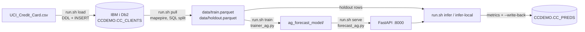

# End-to-end POC: IBM i Db2 → mapepire → AutoGluon → inference

Credit-card default prediction (UCI "Default of Credit Card Clients", 30,000 rows),
with **IBM i Db2 as the system of record**. Everything runs **inside a container** built on top of the
existing forecast image, so nothing is installed on the host Python (no more numpy/ppc64le build failures).



| File | Role |
|------|------|
| [`Containerfile`](Containerfile) | Thin layer on your forecast image: adds `mapepire-python` (+ optional `sshtunnel`), `numpy<2` pinned |
| [`run.sh`](run.sh) | One command per step (`build`, `check`, `load`, `pull`, `train`, `serve`, `infer`, `all`, …) |
| [`schema.sql`](schema.sql) | DDL for `CC_CLIENTS` (data) and `CC_PREDS` (results) |
| [`load_to_ibmi.py`](load_to_ibmi.py) | Creates schema/tables, loads the CSV through mapepire, verifies counts |
| [`pull_from_ibmi.py`](pull_from_ibmi.py) | Pulls rows via mapepire, deterministic 80/20 split in SQL, writes Parquet |
| [`../trainer_ag.py`](../trainer_ag.py) | Existing trainer; reads `TRAIN_DATA_PATH` (Parquet) when set |
| [`../forecast_ag.py`](../forecast_ag.py) | Existing FastAPI service (`POST /forecast`) — unchanged |
| [`infer_from_ibmi.py`](infer_from_ibmi.py) | Scores holdout rows (API or in-process), prints metrics, optional write-back to IBM i |

**How the container is wired.** The image holds only libraries. `run.sh` bind-mounts
`services/forecast` at `/app` and `services/mapepire` at `/opt/mapepire`, so:
- scripts can be edited and re-run without rebuilding the image;
- `data/*.parquet`, `data/predictions.csv` and `ag_forecast_model/` land on the host and survive container exit
  (the model dir is the same one the normal forecast container serves);
- the existing `MapepireConnector` is reused as-is, not copied.

---

## 0. Prerequisites

**On IBM i**
- `mapepire-server` running (default port **8076**), reachable from the RHEL VM.
- A user profile that can `CREATE SCHEMA` (or have an admin pre-create `CCDEMO` and grant `*ALL` on it).
- Optional (SSH-tunnel mode): `sshd` running and your public key in `~/.ssh/authorized_keys`.

**On the RHEL ppc64le VM**
- `podman` (or `docker`; set `CONTAINER_ENGINE=docker`).
- The forecast image you already built for the earlier forecast POC (`services/forecast/Containerfile`).
  Check its name: `podman images | grep -i forecast`. If you no longer have it:

```bash
cd services/forecast
podman build -t forecast:latest .        # long on ppc64le (conda + AutoGluon)
```

---

## 1. Build the POC image and configure credentials

```bash
cd services/forecast/poc_ibmi
./run.sh build localhost/forecast:latest           # pass YOUR forecast image name
# SSH-tunnel mode too:  WITH_SSH_TUNNEL=1 ./run.sh build localhost/forecast:latest
```

The build adds only `mapepire-python` and `python-dotenv`, both installed with a `numpy<2` constraint, then
prints `numpy 1.x` as a self-check. If this build fails, send me the last 30 lines.

Create `.env` (git-ignored). Rules for `podman --env-file`: **no quotes** around values and **no inline
`# comments` after a value** (they would become part of the value). Comments must be on their own line.

```bash
cp ../../mapepire/.env.example .env
```

```ini
IBMI_HOST=my.ibmi.host
IBMI_USER=MYUSER
# IBMI_PASSWORD is ALWAYS required (mapepire passes it to Db2)
IBMI_PASSWORD=changeme
# self-signed mapepire certificate (direct mode)
IBMI_IGNORE_TLS=true

# Optional SSH tunnel (needs WITH_SSH_TUNNEL=1 at build time).
# run.sh decides the mode ONLY from IBMI_SSH_KEY_HOST_PATH: set = tunnel, unset = direct.
# In direct mode run.sh forces IBMI_SSH_KEY_PATH empty inside the container, so a stray
# IBMI_SSH_KEY_PATH line cannot switch the connector to tunnel mode. In tunnel mode run.sh
# mounts the key and sets IBMI_SSH_KEY_PATH itself; you do not need to.
# IBMI_SSH_KEY_HOST_PATH=/root/.ssh/id_rsa

# POC settings (defaults shown; POC_HOLDOUT_MOD=5 means MOD(ID,5)=0 -> 20 percent holdout)
# POC_SCHEMA=CCDEMO
# POC_TABLE=CC_CLIENTS
# POC_PRED_TABLE=CC_PREDS
# POC_HOLDOUT_MOD=5
```

`.env` is bind-mounted into the container along with the rest of `services/forecast`, and
`.dockerignore` excludes `poc_ibmi/.env` and `poc_ibmi/data/` so they never get baked into an image.

Smoke test (connection test, schema listing):

```bash
./run.sh check
```

| Symptom | Fix |
|---------|-----|
| `Connection refused :8076` | start mapepire-server on IBM i; check firewall from the VM (`nc -zv $IBMI_HOST 8076`) |
| `SSL certificate verify failed` | `IBMI_IGNORE_TLS=true` (dev only) |
| `Authentication failed` | wrong IBM i password / profile disabled |
| `CPF` / SQL0551 not authorized | grant authority on the library |
| `.env not found` | `cp ../../mapepire/.env.example .env` |
| `run.sh` prints `connection mode: SSH tunnel` but you want direct | remove/comment `IBMI_SSH_KEY_HOST_PATH` in `.env` |
| `sshtunnel is not installed` (run.sh stops, tunnel mode) | rebuild with `WITH_SSH_TUNNEL=1 ./run.sh build <forecast-image>`, or switch to direct mode |
| `RuntimeError: sshtunnel is not installed` from the connector | the container still received `IBMI_SSH_KEY_PATH`. Using an old `run.sh`? `git pull`/re-copy it; the current one prints `[run.sh] connection mode: ...` first and forces the variable empty in direct mode |

---

## 2. Deploy schema and load the dataset on IBM i

```bash
./run.sh load --dry-run     # review DDL + sample INSERT, touches nothing
./run.sh load               # create + load (60 batches of 500 rows)
```

What it does:
1. Reads `UCI_Credit_Card.csv`, validates the header, and converts to integers
   (the CSV contains values such as `5e+05`, handled).
2. Creates schema `CCDEMO` if absent, then `CREATE OR REPLACE TABLE` for `CC_CLIENTS` and `CC_PREDS`
   (re-runnable; each run starts clean).
3. Multi-row `INSERT … VALUES` in batches of 500 (`./run.sh load --batch 200` to tune).
4. Verifies `COUNT(*) = 30000` (and prints the number of defaults, expected **6636**).

Column mapping: the CSV label `default.payment.next.month` is stored as
`DEFAULT_PAYMENT_NEXT_MONTH` (dots are invalid in SQL identifiers). It is renamed back
when pulling, so the trainer and API need no changes.

Verify independently from a 5250 / ACS Run SQL Scripts session:

```sql
SELECT COUNT(*), SUM(DEFAULT_PAYMENT_NEXT_MONTH) FROM CCDEMO.CC_CLIENTS;   -- 30000, 6636
SELECT * FROM CCDEMO.CC_CLIENTS FETCH FIRST 5 ROWS ONLY;
```

---

## 3. Pull data from IBM i via mapepire

```bash
./run.sh pull               # → poc_ibmi/data/train.parquet, data/holdout.parquet
```

- Split is deterministic and runs in Db2:
  `train: MOD(ID,5) <> 0` (24,000 rows) · `holdout: MOD(ID,5) = 0` (6,000 rows).
- The holdout set is **never** given to the trainer, so metrics in step 5 are honest.
- Uses one open cursor with `ORDER BY ID` and 1,000-row pages (`--page-size`, max 2,000). The mapepire
  client drops any websocket message over 1 MiB (`1009 message too big`) and one row is ~0.4 KB of JSON,
  so 5,000-row pages (about 2 MB) fail.
  Do **not** use `MapepireConnector._run_sql()` / `.extract()` for this volume: they
  page at 100 rows and, once the first page is not final, re-execute the query to
  continue; without a stable order that can duplicate or skip rows.
- Expected log: `train: 24000 rows, default rate ≈0.221`, `holdout: 6000 rows …`.

---

## 4. Train with the forecast POC code

```bash
./run.sh train
```

- Runs `trainer_ag.py` in the container with `TRAIN_DATA_PATH=/app/poc_ibmi/data/train.parquet`.
- To restrict algorithms, run `./run.sh shell` and then `ALGORITHMS=GBM,XGB,CAT TRAIN_DATA_PATH=/app/poc_ibmi/data/train.parquet python /app/trainer_ag.py`.
- Trains with AutoGluon, `roc_auc`, 120 s limit, saves to `services/forecast/ag_forecast_model/`
  (existing contents are cleared first — back it up if you want to keep it).
- Expect a leaderboard and `Best Performing Model`. Reference ROC-AUC for this dataset is roughly 0.77–0.79.
- `Train Score` in the table is computed on the training data (optimistic); use step 5 for real numbers.

---

## 5. Serve the model and run inference

```bash
./run.sh serve                       # detached container "poc-forecast" on :8000
podman logs -f poc-forecast          # wait for "Model loaded successfully."

./run.sh infer --limit 200           # holdout rows via POST /forecast (proves the service)
./run.sh infer-local                 # all 6,000 rows in-process, no HTTP (fast)
./run.sh infer-local --write-back    # also INSERT results into CCDEMO.CC_PREDS
./run.sh stop                        # remove the API container
```

Output: ROC-AUC, accuracy, F1, confusion matrix, and `poc_ibmi/data/predictions.csv`.
`infer` uses host networking so it can reach the published API port (override with `API_PORT=…`).

Single-record check against the API:

```bash
curl -s -X POST localhost:8000/forecast -H 'Content-Type: application/json' -d '{
 "LIMIT_BAL":20000,"SEX":2,"EDUCATION":2,"MARRIAGE":1,"AGE":24,
 "PAY_0":2,"PAY_2":2,"PAY_3":-1,"PAY_4":-1,"PAY_5":-2,"PAY_6":-2,
 "BILL_AMT1":3913,"BILL_AMT2":3102,"BILL_AMT3":689,"BILL_AMT4":0,"BILL_AMT5":0,"BILL_AMT6":0,
 "PAY_AMT1":0,"PAY_AMT2":689,"PAY_AMT3":0,"PAY_AMT4":0,"PAY_AMT5":0,"PAY_AMT6":0}'
# {"status":"success","prediction":1,"probability_of_default":0.6...}
```

Close the loop on IBM i. You do not need a 5250/ACS session or any SQL tool on IBM i: run the SQL from the
VM through the same mapepire connection (read-only; `DELETE`/`DROP`/etc. are refused):

```bash
./run.sh verify          # row count, confusion matrix in SQL, top-10 highest-risk customers
./run.sh sql "SELECT COUNT(*) AS N FROM CCDEMO.CC_PREDS"
./run.sh sql "SELECT PREDICTION, ACTUAL, COUNT(*) AS N FROM CCDEMO.CC_PREDS GROUP BY PREDICTION, ACTUAL ORDER BY 1, 2"
```

Expected: `PRED_ROWS` = 6000, and the four PREDICTION/ACTUAL counts equal the confusion matrix logged by
`infer-local` (TN = PREDICTION 0/ACTUAL 0, FP = 1/0, FN = 0/1, TP = 1/1).

If you prefer to query on IBM i itself over SSH, use the Db2 for i `db2` CLI from `qsh` (QShell) after `ssh user@host`:

```sh
qsh
db2 "SELECT COUNT(*) FROM CCDEMO.CC_PREDS"
db2 "SELECT PREDICTION, ACTUAL, COUNT(*) FROM CCDEMO.CC_PREDS GROUP BY PREDICTION, ACTUAL ORDER BY 1, 2"
```

The `db2` QShell utility is part of the base OS. The command and its exact behaviour were not verified for this POC
(no IBM i shell access here), so prefer `./run.sh verify`.

---

## 6. One-shot run

```bash
./run.sh build localhost/forecast:latest      # once
./run.sh all                                   # load -> pull -> train -> infer-local --write-back
```

## 7. Success criteria

| Check | Expected |
|-------|----------|
| `./run.sh build` self-check | prints `numpy 1.x` |
| IBM i row count | 30,000 (6,636 defaults) |
| Pulled | train 24,000 · holdout 6,000 |
| Holdout ROC-AUC | ≳ 0.75 (≈0.77–0.79 typical) |
| `/forecast` returns `probability_of_default` | yes |
| `CC_PREDS` rows after `--write-back` | = holdout size scored |

## 8. Troubleshooting

| Symptom | Cause / fix |
|---------|-------------|
| `base image '…' not found` | `podman images`; pass the right name to `./run.sh build <image>` or build it (§0) |
| Build step fails on `pip install` | send the last 30 lines; `numpy<2` is enforced, so a `numpy>=2` error names a dependency to pin |
| `Permission denied` on `/app/...` writes | SELinux/ownership of the bind mount: `ls -ldZ services/forecast`; `run.sh` already uses `:z` |
| `Non-integer value in row` | CSV edited; every field must be a whole number |
| `SQL0204 … not found` | wrong `POC_SCHEMA`/`POC_TABLE`, or step 2 not run |
| `Failed to run query: … SQL0104` on INSERT | very wide batch; `./run.sh load --batch 200` |
| `ConnectionClosedError: 1009 (message too big)` during pull | page too large for the 1 MiB websocket limit; use the current `pull_from_ibmi.py` (default 1,000) or `./run.sh pull --page-size 500` |
| Pull returns fewer than 24,000/6,000 rows | `./run.sh pull --page-size 500`; check `mapepire-server` logs |
| `KeyError: 'DEFAULT_PAYMENT_NEXT_MONTH'` in pull | Db2 returned a different column case; confirm with a direct `SELECT` |
| `train` says `data/train.parquet missing` | run `./run.sh pull` first |
| `serve` says no trained model | run `./run.sh train` first |
| `infer` connection refused | `podman logs poc-forecast`; model load takes a few seconds |
| SSH tunnel: `sshtunnel is not installed` | rebuild with `WITH_SSH_TUNNEL=1 ./run.sh build <image>` |

## 9. Beyond the POC

- Fold `mapepire-python` into `services/forecast/Containerfile` and drop this layer.
- Register `MapepireConnector` in `common/data_connector.get_data_connector()` (`db_type="mapepire"`).
  It currently lives in `services/mapepire` with its own inline ABC and a 100-row paging path that would need the
  single-cursor approach used in `pull_from_ibmi.py`. (The existing `Db2iConnector` uses JT400/JDBC on port 446;
  mapepire is the alternative that needs no Java.)
- Move the password to a secret and use SSH-tunnel mode in shared environments.
